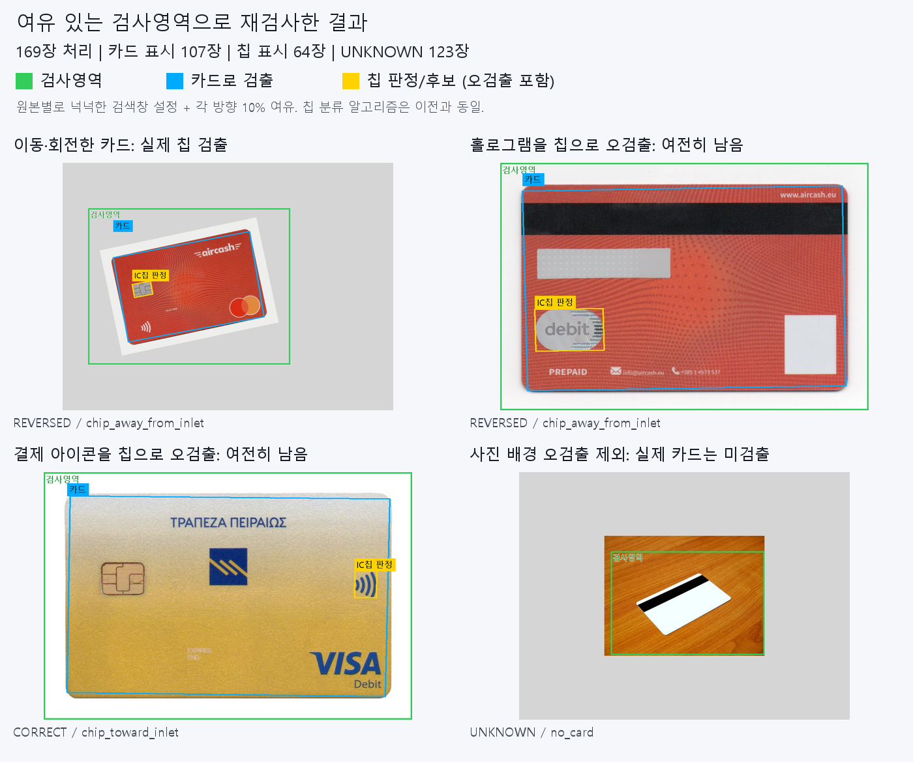

# MECapstone — 카드 IC칩 비전 및 정렬 판단

녹화 영상·단일 이미지에서 카드와 IC 접점을 검출하고, 카드 방향과 필요한 기구 동작을 시각화하는 Python/OpenCV 프로젝트입니다. 파일 입력·비전 처리·동작 판단을 분리해 PC에서 검증한 후 Raspberry Pi와 실제 카메라에 연결할 수 있도록 구성했습니다.

## 실행

Python 3.10 이상을 사용합니다. Windows PowerShell 예시:

```powershell
cd card_vision
py -3.12 -m venv .venv
.\.venv\Scripts\python.exe -m pip install -r requirements.txt
.\.venv\Scripts\python.exe tools/generate_demo.py
.\.venv\Scripts\python.exe main.py --source data/test/demo_correct.avi
```

```powershell
# 단일 이미지
.\.venv\Scripts\python.exe main.py --source data/images/card.jpg
# 폴더 일괄 처리: CSV/JSON 및 검출 박스 이미지 저장
.\.venv\Scripts\python.exe main.py --batch data/images --recursive --save-annotated
# 테스트
.\.venv\Scripts\python.exe -m unittest discover -s tests -v
```

Linux에서는 `python3 -m venv .venv`, `.venv/bin/python`을 사용합니다. 파일 선택창·재생 키·Headless·정답 라벨·설정은 [상세 사용 설명](card_vision/README.md)을 참고하세요.

## 구현 내용

- 카드 외곽·원근 보정, 금색/은색 IC 접점 후보 검출 및 방향 판단.
- 카드보다 넉넉한 고정 검색창과 각 방향 추가 여백 설정.
- 프레임 안정화 및 동작 완료 신호를 기다리는 상태 머신.
- `FLIP → 재확인`, `ROTATE_180 → 재확인`, `INSERT` 모의 동작.
- JPG/JPEG/PNG 등 단일 이미지 검토, 하위 폴더별 Batch 비교, 선택적 정답 라벨 평가.
- 중간 처리 화면, 메타데이터 로그, 명시적으로 선택하는 결과 이미지 저장.

**실제 모터 출력은 구현하지 않았습니다.** 모든 동작은 Mock Actuator입니다. 이미지 모드는 동작 제안만 표시하며 명령을 발생시키지 않습니다.

## 카드 이미지 검증 결과

Wikimedia Commons 원본 13장과 그 평면 변형 156장, 총 169장에 대한 결과 이미지를 포함했습니다. 같은 원본의 변형은 독립적인 카드 종류가 아닙니다.

| 실행 | 카드 검출 표시 | 칩 검출 표시 | UNKNOWN |
|---|---:|---:|---:|
| 전체 화면 검사 | 119/169 | 64/169 | 111/169 |
| 여유 있는 검색창 적용 | 107/169 | 64/169 | 123/169 |

**검출 표시는 정확도가 아닙니다.** 홀로그램·결제 아이콘을 칩으로 오인하는 문제가 남아 있습니다. 칩 없는 뒷면 91장 중 19장에서 칩 검출 표시가 발생했습니다. 검색창 적용으로 사진 배경을 카드로 잡던 일부 결과가 UNKNOWN으로 바뀌었으며, 칩 분류기 자체를 개선한 결과는 아닙니다.



- [첫 검사 보고서](card_vision/outputs/topdown_kit_baseline/TEST_REPORT.md) · [첫 검사 전체 169장](card_vision/outputs/topdown_kit_baseline/batch_20261024_153642_f36f4efa/annotated)
- [검색창 적용 보고서](card_vision/outputs/topdown_roi_retest/REPORT.md) · [재검사 전체 169장](card_vision/outputs/topdown_roi_retest/annotated)
- [전후 이미지 비교](card_vision/outputs/topdown_roi_retest/before_after.png) · [재검사 CSV](card_vision/outputs/topdown_roi_retest/results.csv)
- [테스트·미검증 항목](card_vision/VALIDATION.md) — Windows PC에서 37개 테스트 통과. 실제 기구·검정 필라멘트 바닥·Pi 성능은 미검증.

원본별 검사창을 키트의 이동/회전 정보로 환산한 오프라인 실험이며, 고정된 실물 카메라에서 하나의 검색창을 사용한 시험은 아닙니다.

## 데이터와 이미지 출처

검증 결과 이미지의 원본 저작자·라이선스·출처와 가공 내용은 [이미지 출처 및 라이선스](card_vision/IMAGE_ATTRIBUTIONS.md)에 정리했습니다. 공개된 테스트 이미지의 파생 결과이며 사용자의 실제 카드 영상은 포함하지 않습니다. 원본 이미지·개인 촬영 데이터·가상환경·설치 패키지·일반 실행 로그는 Git 추적에서 제외합니다.

기존 저장소 내용은 `backup/before-card-vision-2026-10-25` 브랜치에 보존했습니다.
